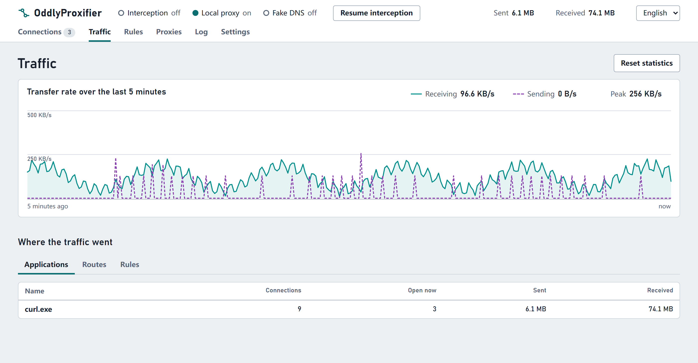
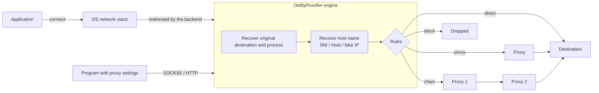
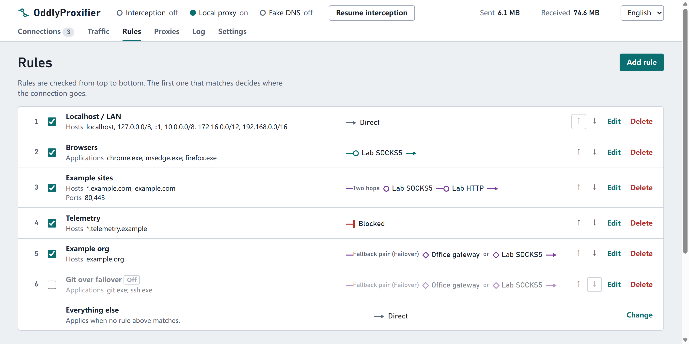

<div align="center">


# OddlyProxifier

**Send programs that have no proxy settings through SOCKS / HTTPS proxies and proxy chains, by rule.**

Open source, cross-platform, one executable.

[](https://github.com/OddlyLabs/OddlyProxifier/releases/latest)
[](https://github.com/OddlyLabs/OddlyProxifier/releases)
[](go.mod)
[](#platform-support)
[](LICENSE)

[简体中文](README.md) · **English**

[Quick start](#quick-start) · [Features](#features) · [Rules](#rules) · [Configuration](#configuration) · [Platforms](#platform-support) · [FAQ](#faq) · [Architecture](docs/ARCHITECTURE.md)

<picture>
  <source media="(prefers-color-scheme: dark)" srcset="docs/images/traffic-dark-en.png">
  
</picture>

</div>

## What it is

Many programs have no proxy settings: game clients, command-line tools, old enterprise software. OddlyProxifier takes over
their outbound connections at the system level and decides, by rules you write, whether each connection goes
**directly, is blocked, goes through a proxy, or through a chain of proxies**. The programs themselves are not changed.

It does the same job as Proxifier, with these differences:

- **Open source** under the MIT license; the code can be audited.
- **One program for three systems**: Windows, Linux and macOS share one configuration format and one interface.
- **No runtime dependencies**: a single executable built with Go, with the management interface embedded and opened in a browser.

> [!NOTE]
> The project is at an early stage (0.2). Transparent interception has been tested on Windows and Linux; the macOS backend
> has never run on a real machine. What has and has not been verified is listed under [Known limitations](#known-limitations).

## Features

| | |
|---|---|
| **Proxy protocols** | SOCKS5 (with username / password), SOCKS4, SOCKS4a, HTTP CONNECT (with Basic authentication), HTTPS (CONNECT over TLS) |
| **Proxy chains** | `chain` hop after hop · `failover` the first proxy that works · `balance` round robin with failover; a failed proxy is skipped for 30 seconds |
| **Rules** | Match by application, destination host and port; actions are direct / block / proxy / chain; the first matching rule from the top wins |
| **Transparent interception** | Redirects outbound TCP at the system level and identifies the process behind each connection; one switch at the top of the interface |
| **Proxy inbound** | A local mixed SOCKS5 / SOCKS4 / HTTP port that needs no administrator rights; SOCKS5 UDP relay |
| **Host names** | Recovered from TLS SNI and HTTP Host; optional fake-IP DNS so the proxy resolves names; a list of internal names that always resolve locally |
| **Management interface** | Live connections, traffic chart and usage, log, proxy tests, rule tester; English / Chinese, light / dark |
| **Profiles** | Save and switch by name; export / import; **imports Proxifier `.ppx` files** |
| **Runs with the system** | Windows service / systemd unit / launchd daemon; Windows notification-area icon and start at sign-in |

## How it works



The interception backend only rewrites where a connection goes, so that it reaches the engine; the engine then forwards it
according to the rules. The design and the driver interface are described in [docs/ARCHITECTURE.md](docs/ARCHITECTURE.md).

## Quick start

### 1. Download

Get the archive for your platform from [Releases](https://github.com/OddlyLabs/OddlyProxifier/releases/latest) and unpack it. `SHA256SUMS` lists the checksums.

| Platform | File |
|---|---|
| Windows x64 | `oddlyproxifier-<version>-windows-amd64.zip` |
| Linux x64 / arm64 | `oddlyproxifier-<version>-linux-amd64.tar.gz` / `-linux-arm64.tar.gz` |
| macOS Intel / Apple silicon | `oddlyproxifier-<version>-darwin-amd64.tar.gz` / `-darwin-arm64.tar.gz` |

### 2. Run

**Windows**: double-click `oddlyproxifier.exe`, or in a terminal:

```powershell
.\oddlyproxifier.exe -open
```

**Linux / macOS**:

```bash
sudo ./oddlyproxifier
```

The terminal prints the address of the management interface, such as `http://127.0.0.1:9090/#token=…`. Open it in a browser.

### 3. Add a proxy and a rule

Add a proxy server on the **Proxies** page and press **Test** to confirm it works. Then add a rule on the **Rules** page, for example
"`chrome.exe` → through this proxy". Changes apply as soon as they are saved.

### Two ways to use it

| | Transparent interception | Proxy inbound |
|---|---|---|
| For | Programs without proxy settings | Programs that accept a proxy address |
| Rights | Administrator / root | Ordinary user |
| How | The engine takes over the system's outbound connections | Set the program's proxy to `127.0.0.1:1080` |
| Extra on Windows | Needs the kernel driver, see [Windows](#windows) | Nothing |

Without administrator rights, or without the driver, the engine still starts and offers the proxy inbound only; rules apply to
connections that come in that way too. `-no-intercept` chooses this mode on purpose.

## Rules

<div align="center">
<picture>
  <source media="(prefers-color-scheme: dark)" srcset="docs/images/rules-dark-en.png">
  
</picture>
</div>

A rule has three optional conditions and one action. An empty condition means "any":

| Condition | Examples |
|---|---|
| Application | `chrome.exe` · `*\Steam\*` · `/usr/bin/curl` |
| Destination host | `*.example.com` · `10.0.0.0/8` · `1.1.1.1-1.1.1.9` · `localhost` |
| Port | `443` · `80,443,8000-9000` |

Rules are matched from the top and the first match decides. When none matches, the action of **Everything else** applies.

Not sure where a connection would go? Use **Try a connection** at the bottom of the page, or the command line:

```console
$ oddlyproxifier match -app chrome.exe -host www.example.com -port 443
rule:   Browsers
action: proxy Lab SOCKS5
```

## Command line

```
oddlyproxifier [run] [flags]     start the engine and the management interface
    -profile file   -api address   -log debug|info|warn|error|off   -no-intercept   -open
    -tray on|off|auto            Windows notification-area icon (auto: shown when started by double-click)
oddlyproxifier check             test the proxies and chains of the profile
oddlyproxifier match -app program -host host -port port
                                 show which rule a connection would match
oddlyproxifier service status|install|start|stop|uninstall
                                 run with the system (install accepts -profile and -api)
oddlyproxifier tray [-api address] [-profile file] [-autostart on|off]
                                 Windows: show the notification-area icon for a running engine
oddlyproxifier driver status|install|start|stop|uninstall
                                 manage the Windows driver
oddlyproxifier cleanup           remove redirect rules left behind by an engine that did not exit cleanly
oddlyproxifier version
```

## Configuration

The profile is one JSON file. The management interface reads and writes it; it can also be written by hand, and fields left out take their defaults.

- Location: `OddlyProxifier/profile.json` in the user's configuration directory (`%AppData%` on Windows); `-profile file` selects another.
- Defaults: local network and loopback go directly, everything else goes directly, proxy inbound on `127.0.0.1:1080`, management interface on `127.0.0.1:9090`.

<details>
<summary><b>Full example</b></summary>

```json
{
  "version": 1,
  "proxies": [
    {"id": "office", "name": "Office SOCKS5", "type": "socks5", "host": "10.0.0.8", "port": 1080,
     "username": "user", "password": "secret"},
    {"id": "exit", "name": "Exit HTTPS", "type": "https", "host": "proxy.example.com", "port": 443}
  ],
  "chains": [
    {"id": "two-hop", "name": "Office then exit", "type": "chain", "proxies": ["office", "exit"]}
  ],
  "rules": [
    {"id": "lan", "name": "LAN", "enabled": true,
     "hosts": ["localhost", "10.0.0.0/8", "192.168.0.0/16"], "action": {"type": "direct"}},
    {"id": "git", "name": "Git over the chain", "enabled": true,
     "apps": ["git.exe", "ssh.exe"], "ports": "22,443", "action": {"type": "chain", "target": "two-hop"}},
    {"id": "ads", "name": "Ads", "enabled": true,
     "hosts": ["*.ads.example"], "action": {"type": "block"}}
  ],
  "default": {"type": "proxy", "target": "office"},
  "dns": {"mode": "auto", "sniff": true, "local_names": ["*.corp.example", "printer"],
          "fake": {"enabled": false, "listen": "127.0.0.1:53", "range": "198.18.0.0/15", "upstream": ""}},
  "options": {
    "intercept": true, "ipv6": true, "block_quic": true, "handle_direct": false,
    "transparent_port": 37080, "target_port": 0,
    "inbound": "127.0.0.1:1080", "udp": true, "api": "127.0.0.1:9090",
    "connect_timeout": 15, "idle_timeout": 0,
    "log_file": "", "log_level": "info"
  }
}
```

</details>

| Field | Meaning |
|---|---|
| `proxies[].type` | `socks5`, `socks4`, `socks4a`, `http`, `https`; `https` also takes `tls_server_name` and `tls_insecure` |
| `chains[].type` | `chain`, `failover`, `balance` |
| `rules[].apps` / `hosts` / `ports` | See [Rules](#rules); empty means any |
| `default` | The action when no rule matches |
| `dns.mode` | `auto` / `remote`: the proxy resolves the name when it is known; `local`: resolve here and give the proxy an IP address |
| `dns.sniff` | Recover the host name from TLS SNI / HTTP Host, so that host rules work for transparent connections |
| `dns.local_names` | Names that always resolve locally (same wildcards as `hosts`), for internal names the proxy does not know |
| `dns.fake` | Fake-IP DNS: answers queries with addresses from `198.18.0.0/15` and hands the name to the proxy on connect |
| `options.intercept` | Transparent interception on or off; the switch at the top of the interface changes this |
| `options.inbound` / `udp` | Listening address of the proxy inbound; whether SOCKS5 UDP ASSOCIATE is accepted |
| `options.block_quic` | Refuse UDP/443 of intercepted traffic so that browsers fall back from QUIC to TCP |
| `options.handle_direct` | Also pass connections that can only go directly through the engine, to see every connection in the interface |
| `options.log_file` / `log_level` | Also write the log to this file, from this level up; beyond 5 MB the file is renamed to `<file>.1` and started again |
| `options.target_port` | For debugging: intercept only this destination port; `0` means all |
| `options.api_token` | Access token of the management API; generated and saved when absent |

### Several profiles, and moving from Proxifier

Under **Settings → Profiles** the current profile can be saved under a name, and you can switch between saved profiles. They are kept in the `profiles/` directory beside the profile file.
Switching or importing replaces proxies, chains, rules and name resolution only; what belongs to this computer (ports, access token, log file) stays.

- **Export** gives a JSON file, without proxy passwords by default; when you ask for them they are written in clear text.
- **Import** accepts JSON exported by this program and Proxifier `.ppx` files.

A `.ppx` import brings SOCKS4 / SOCKS5 / HTTPS proxies, chains, rules (applications, targets, ports), the default rule and the name-resolution exclusion list.
Everything that could not be brought over is listed: unsupported proxy types (such as SSH) and the chains and rules that use them. Passwords that Proxifier stored encrypted cannot be read and must be entered again.

## Platform support

| Platform | Transparent interception | Status |
|---|---|---|
| Windows 10 / 11 x64 | WFP kernel driver `OddlyDrv.sys` | Tested in a Windows 11 virtual machine |
| Linux | nftables (falls back to iptables) `REDIRECT` | Tested in a Linux network namespace |
| macOS | pf `rdr` + `route-to` | Experimental: compiles, **never run on a real machine** |

The proxy inbound and the management interface run without special rights on all three.

### Windows

> [!IMPORTANT]
> Transparent interception needs the kernel driver `OddlyDrv.sys`, and **the release archives do not contain it**: Windows loads only signed drivers, and this project has no signature that can be distributed.
> You can build the driver and sign it with a test certificate, for a machine with test signing enabled (a virtual machine is the place to start). Without the driver, the proxy inbound and the management interface work as usual.

<details>
<summary><b>Build, sign and load the driver</b></summary>

Needs Visual Studio 2022 Build Tools and WDK 10.0.26100. Set the environment variable `WDKROOT` when the WDK is not in its default place.

```bat
cd driver
build.bat
sign.bat <certificate.pfx> <password>
```

On the target machine, trust the certificate and enable test signing (as administrator; restart once afterwards):

```bat
bcdedit /set testsigning on
```

Put `OddlyDrv.sys` next to `oddlyproxifier.exe` (or in `driver\` below it) and start the engine as administrator; it registers and starts the driver service by itself.
`oddlyproxifier driver install|start|stop|uninstall` does the same by hand.

Distribution to the public needs an EV code-signing certificate and attestation signing by Microsoft.

</details>

<details>
<summary><b>What the driver does and does not do</b></summary>

- It only rewrites the destination of outbound TCP connections. It neither reads nor changes data.
- The engine's own process, connections to the proxy servers, loopback and multicast addresses are not redirected.
- When the engine exits or crashes (its handle closes), the driver drops the policy at once and connections go directly again.
- Only SYSTEM and administrators can open the device.

</details>

<details>
<summary><b>Running as a service; the notification-area icon</b></summary>

As administrator:

```powershell
oddlyproxifier service install
oddlyproxifier service start
```

The service is named `OddlyProxifier`, starts with the system, runs as SYSTEM and uses the profile given with `-profile` at install time (by default your own; the path is printed).
Removing the service does not remove the driver; use `oddlyproxifier driver stop` and `driver uninstall` for that.

**Notification-area icon**: shown when the program is started by double-click (`-tray on|off` forces it). Its menu opens the management interface, switches interception and quits.
When the engine runs as a service, `oddlyproxifier tray` shows the icon on its own, and `oddlyproxifier tray -autostart on` makes it appear at sign-in
(a value under the current user's `HKCU\Software\Microsoft\Windows\CurrentVersion\Run`; `-autostart off` removes it).

</details>

Fake-IP DNS does not take over the system DNS on Windows: after enabling it, point the network adapter's DNS server at the `dns.fake.listen` address by hand.
Once the engine stops, nothing answers at that address and name resolution fails, so set the DNS server back.

### Linux

Run as root. The engine installs `REDIRECT` rules in `nat OUTPUT` (nftables first, iptables when `nft` is missing),
excludes its own traffic with `SO_MARK`, recovers the original destination with `SO_ORIGINAL_DST` and identifies processes through netlink and `/proc`.

- The kernel cannot filter by program name, so all outbound TCP enters the engine first and the rules then decide between direct and proxy.
- With fake-IP DNS enabled, UDP/53 to non-loopback addresses is redirected to the fake DNS service.
- A guard child process removes the rules when the engine is killed; if something is still left, run `oddlyproxifier cleanup`.
- `sudo oddlyproxifier service install` writes the systemd unit `/etc/systemd/system/oddlyproxifier.service` and enables it at boot.

> [!WARNING]
> **Transparent interception does not work under WSL2 mirrored networking (`networkingMode=mirrored`)**: the system does not keep the original destination of redirected connections. The engine warns once and refuses those connections.
> Use NAT networking, or the proxy inbound only.

### macOS (experimental)

Run as root. Uses the pf anchor `com.apple/250.OddlyProxifier` and `DIOCNATLOOK`. The engine excludes itself by `user != root`, so connections of other root processes are not intercepted either.
`sudo oddlyproxifier service install` writes a launchd daemon plist to `/Library/LaunchDaemons/`.

This code compiles and passes static checks but has never run on a real machine; treat it as unverified. Reports from real machines are [welcome](https://github.com/OddlyLabs/OddlyProxifier/issues).

## Security

- The management interface and the API listen on this machine only. Every `/api/` request needs the access token, and requests whose `Host` is not a local name are refused (protection against DNS rebinding).
- The page carries a strict content security policy; all scripts come from the executable and nothing is loaded from elsewhere.
- The engine does not decrypt traffic: host names come only from the clear-text SNI of the TLS handshake or the HTTP Host header.
- A connection that matches a proxy rule and cannot be delivered through the proxy fails. It is **never** sent directly instead.
- Proxy passwords are stored in clear text in the profile file; protect that file. Exports leave passwords out by default.

Please report security problems privately through GitHub [Security Advisories](https://github.com/OddlyLabs/OddlyProxifier/security/advisories/new).

## Known limitations

- Transparent interception handles TCP only; it can block UDP/443 to make QUIC fall back to TCP.
- UDP is relayed only on the proxy inbound, through SOCKS5 UDP ASSOCIATE: directly, or through **one** SOCKS5 proxy. HTTP / HTTPS / SOCKS4 proxies and multi-hop chains cannot carry UDP; UDP traffic that matches them is dropped.
- Host names are recovered from TLS SNI and HTTP Host only. With encrypted SNI (ECH) or other protocols, only IP rules match unless fake-IP DNS is enabled.
- There is no native graphical interface; the management interface is a local web page. Only Windows has a notification-area icon. There is no installer, and the program is not code-signed, so the system may show a security prompt on first run.

**What has been verified**

| Tested | Not yet tested |
|---|---|
| Windows driver: per-program and all-program interception, IPv6 redirect, concurrent connections, block rules, host rules, QUIC blocking, recovery after the engine is killed | Double-click on the notification-area icon and the elevation prompt |
| Fake-IP DNS on Windows: with the adapter pointed at it by hand, by name through a proxy and directly | The launchd install |
| Windows service: install, start with the system, interception, stop, uninstall | The macOS backend |
| `tray` command: switching interception, closing the icon, start at sign-in | QUIC fallback in a real browser |
| Linux transparent interception: proxy and direct, process identification, cleanup after a kill | |
| systemd: install, enabled at boot, start, restart after a kill, stop, uninstall | |
| Management interface: every page in both languages and both colour schemes | |

## FAQ

<details>
<summary><b>Windows says the driver is unavailable. What now?</b></summary>

The release archives do not contain the driver. Either build and sign it as described under [Windows](#windows), or use the proxy inbound only: set the program's proxy to `127.0.0.1:1080`, and the rules apply all the same.

</details>

<details>
<summary><b>Can it see the content of my traffic?</b></summary>

It does not decrypt anything. The engine forwards bytes; to make host rules work it reads the clear-text start of a connection (the SNI of TLS or the Host of HTTP).

</details>

<details>
<summary><b>A rule written for a host name does not match.</b></summary>

A transparent connection reaches the engine with an IP address only. Check that host-name sniffing is on in Settings; for protocols it cannot read, enable fake-IP DNS. `oddlyproxifier match` or **Try a connection** in the interface checks the rule itself.

</details>

<details>
<summary><b>Part of my browser's traffic does not go through the proxy.</b></summary>

Most likely QUIC (UDP/443). Keep `options.block_quic` on and the browser falls back to TCP.

</details>

<details>
<summary><b>The network is down after the engine crashed.</b></summary>

On Windows the driver lets traffic through as soon as the engine's handle closes; on Linux / macOS the guard process cleans up. If something is still left, run `oddlyproxifier cleanup`.

</details>

<details>
<summary><b>I lost the address or the token of the management interface.</b></summary>

The engine prints the full address when it starts; the token is also in the `options.api_token` field of the profile file.

</details>

## Building from source

Needs Go 1.26 or newer. No cgo.

```bash
go build -trimpath -ldflags "-s -w" -o oddlyproxifier ./cmd/oddlyproxifier
```

Build and pack every platform in one go:

```bash
go run ./tools/release
```

Archives and `SHA256SUMS` go to `dist/`. `-out dir` changes the place, `-only linux/arm64,windows/amd64` builds just those, and `-no-driver` leaves the driver out of the Windows archive.

### Releasing

Releases are made by GitHub Actions ([.github/workflows/release.yml](.github/workflows/release.yml)). Set `Version` in `internal/engine/engine.go`, commit, and push a tag of the same name:

```bash
git tag v0.3.0
git push origin v0.3.0
```

The workflow checks that the tag matches `Version`, runs `gofmt`, `go vet` and the tests, packs every platform (the Windows archive without the driver), then creates the release and uploads the archives with `SHA256SUMS`.
Started by hand from the Actions page it only tests and packs: the archives are kept as an artifact of that run and nothing is published.

### Tests

```bash
go test ./...
```

| Tool | Purpose |
|---|---|
| `tools/linux_test.sh` | Checks Linux transparent interception in a separate network namespace (root) |
| `tools/testproxy` | SOCKS5 / SOCKS4 / HTTP / HTTPS test proxy and echo service for manual trials |
| `tools/trayprobe.ps1` | Checks that the Windows notification-area icon is registered and can send it menu commands |
| `tools/test_e2e.py` | Local end-to-end test of the C / Python reference engines |

### Layout

| Path | Contents |
|---|---|
| `cmd/oddlyproxifier/` | Program entry and command line |
| `internal/config`, `rules`, `proxy` | Profile, rule matching, proxy protocols and chains |
| `internal/profiles`, `ppx` | Named profiles, Proxifier `.ppx` import |
| `internal/intercept`, `procinfo` | Interception backends and process identification per platform |
| `internal/engine`, `sniff`, `dnsx` | Sessions, UDP relay, traffic statistics, log, host-name sniffing, fake-IP DNS |
| `internal/api`, `proxytest` | HTTP API with the embedded management interface, proxy tests |
| `internal/service`, `tray` | System service (SCM / systemd / launchd), Windows notification-area icon |
| `driver/` | WFP driver `OddlyDrv.sys`; the interface is defined in `driver/oddly_ioctl.h` |
| `engine/`, `pyengine/` | Minimal C / Python reference implementations of the driver interface (one SOCKS5 proxy, no rules) |
| `tools/release` | Build and packaging for every platform |

## Contributing

[Issues](https://github.com/OddlyLabs/OddlyProxifier/issues) and pull requests are welcome. What helps most right now:

- Trying transparent interception on a real Mac and reporting what happens.
- Verifying the items in the [not yet tested](#known-limitations) column.
- Reporting a program that misbehaves when taken over, with the log (set the log level to **Everything** in Settings).

Please run `gofmt`, `go vet ./...` and `go test ./...` before sending code.

## License

[MIT](LICENSE)

Proxifier is a trademark of its owner. This project is an independent open-source implementation and is not affiliated with Proxifier or its developers.
