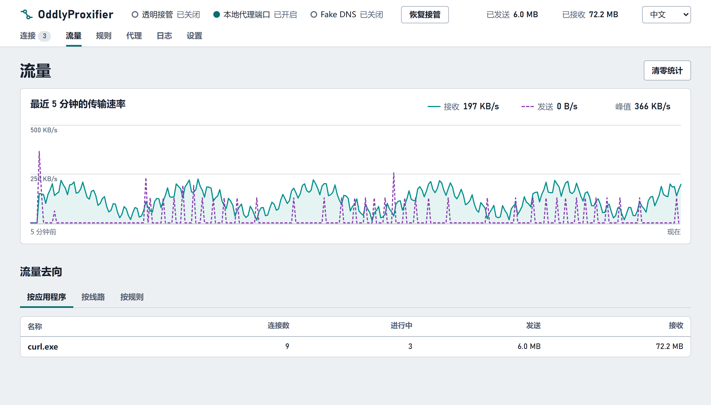
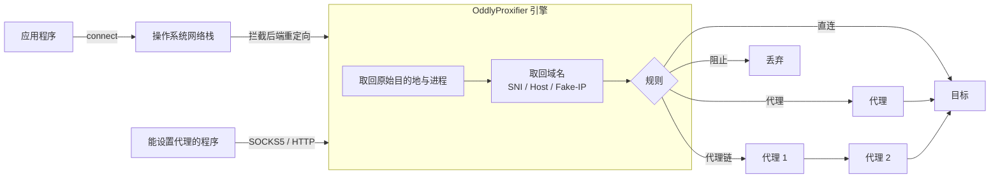
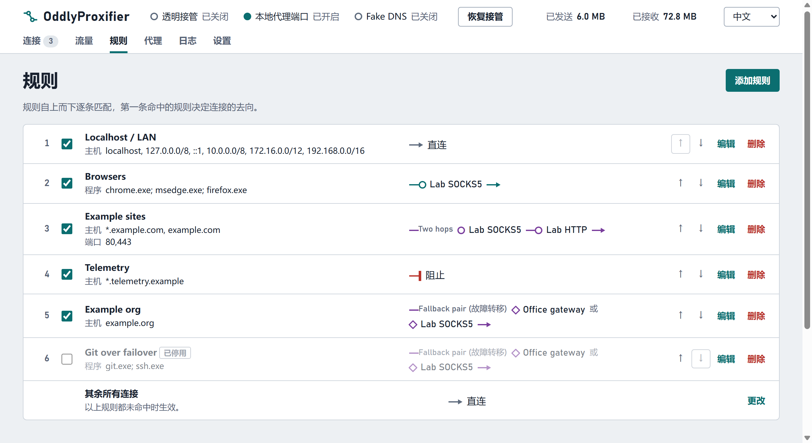

<div align="center">


# OddlyProxifier

**让不支持代理设置的程序，按规则通过 SOCKS / HTTPS 代理与代理链联网。**

开源、跨平台、单个可执行文件。

[](https://github.com/OddlyLabs/OddlyProxifier/releases/latest)
[](https://github.com/OddlyLabs/OddlyProxifier/releases)
[](go.mod)
[](#平台支持)
[](LICENSE)

**简体中文** · [English](README.en.md)

[快速开始](#快速开始) · [功能](#功能) · [规则](#规则) · [配置](#配置文件) · [平台说明](#平台支持) · [常见问题](#常见问题) · [架构](docs/ARCHITECTURE.md)

<picture>
  <source media="(prefers-color-scheme: dark)" srcset="docs/images/traffic-dark.png">
  
</picture>

</div>

## 这是什么

很多程序没有代理设置：游戏客户端、命令行工具、老旧的企业软件。OddlyProxifier 在系统层面接管它们的出站连接，
按你写的规则决定每条连接**直连、阻止、走某个代理，还是走一条代理链**，程序本身不需要任何改动。

它的定位与 Proxifier 相同，区别在于：

- **开源**，MIT 许可，代码可以审计。
- **一个程序覆盖三个系统**：Windows、Linux、macOS 共用同一份配置和同一个界面。
- **没有运行时依赖**：一个 Go 编译的可执行文件，管理界面内嵌其中，在浏览器里打开。

> [!NOTE]
> 项目处于早期阶段（0.2）。Windows 与 Linux 的透明拦截经过实测，macOS 后端尚未在真机上运行过。
> 每一项的验证情况都如实写在[已知限制](#已知限制)里。

## 功能

| | |
|---|---|
| **代理协议** | SOCKS5（含用户名 / 密码）、SOCKS4、SOCKS4a、HTTP CONNECT（含 Basic 认证）、HTTPS（TLS 上的 CONNECT） |
| **代理链** | `chain` 逐跳串联 · `failover` 第一个可用的代理 · `balance` 轮询并带故障切换；失败的代理暂停 30 秒 |
| **规则** | 按应用程序、目标主机、端口匹配；动作为直连 / 阻止 / 代理 / 代理链；自上而下第一条命中的生效 |
| **透明拦截** | 系统级重定向出站 TCP 并识别发起连接的进程；界面顶部一键开关 |
| **代理入口** | 本机 SOCKS5 / SOCKS4 / HTTP 混合端口，无需管理员权限；支持 SOCKS5 UDP 转发 |
| **域名处理** | 从 TLS SNI 与 HTTP Host 取回域名；可选 Fake-IP DNS 让代理端解析；可指定始终在本机解析的内网域名 |
| **管理界面** | 实时连接、流量曲线与用量统计、日志、代理测试、规则试算；中 / 英文，浅色 / 深色 |
| **多份配置** | 按名字保存与切换；导出 / 导入；**可直接导入 Proxifier 的 `.ppx`** |
| **随系统运行** | Windows 服务 / systemd 单元 / launchd 守护进程；Windows 通知区域图标与登录自启动 |

## 工作原理



拦截后端只改写连接的目的地址，把它送进引擎；引擎再按规则转发。详细设计与驱动接口见 [docs/ARCHITECTURE.md](docs/ARCHITECTURE.md)。

## 快速开始

### 1. 下载

从 [Releases](https://github.com/OddlyLabs/OddlyProxifier/releases/latest) 下载对应平台的压缩包并解压，`SHA256SUMS` 可用于校验。

| 平台 | 文件 |
|---|---|
| Windows x64 | `oddlyproxifier-<版本>-windows-amd64.zip` |
| Linux x64 / arm64 | `oddlyproxifier-<版本>-linux-amd64.tar.gz` / `-linux-arm64.tar.gz` |
| macOS Intel / Apple 芯片 | `oddlyproxifier-<版本>-darwin-amd64.tar.gz` / `-darwin-arm64.tar.gz` |

### 2. 运行

**Windows**：双击 `oddlyproxifier.exe`，或在终端里：

```powershell
.\oddlyproxifier.exe -open
```

**Linux / macOS**：

```bash
sudo ./oddlyproxifier
```

终端会打印管理界面的地址，形如 `http://127.0.0.1:9090/#token=…`，在浏览器里打开它。

### 3. 添加代理与规则

在界面的「代理」页添加代理服务器，点「测试」确认可用；再到「规则」页添加规则，例如「`chrome.exe` → 走这个代理」。保存后立即生效。

### 两种使用方式

| | 透明拦截 | 代理入口 |
|---|---|---|
| 适用 | 没有代理设置的程序 | 能填代理地址的程序 |
| 权限 | 管理员 / root | 普通用户 |
| 做法 | 引擎接管系统的出站连接 | 把程序的代理设为 `127.0.0.1:1080` |
| Windows 额外条件 | 需要内核驱动，见 [Windows 说明](#windows) | 无 |

没有管理员权限、或者没有驱动时，引擎照常启动，只提供代理入口；规则对从入口进来的连接同样生效。
用 `-no-intercept` 可以主动只用代理入口。

## 规则

<div align="center">
<picture>
  <source media="(prefers-color-scheme: dark)" srcset="docs/images/rules-dark.png">
  
</picture>
</div>

一条规则由三个可选条件和一个动作组成，条件留空表示「任意」：

| 条件 | 写法举例 |
|---|---|
| 应用程序 | `chrome.exe` · `*\Steam\*` · `/usr/bin/curl` |
| 目标主机 | `*.example.com` · `10.0.0.0/8` · `1.1.1.1-1.1.1.9` · `localhost` |
| 端口 | `443` · `80,443,8000-9000` |

规则自上而下匹配，第一条命中的决定连接去向；都不命中时使用「其余所有连接」的默认动作。

不确定一条连接会怎么走？在界面底部「试一试」，或者用命令行：

```console
$ oddlyproxifier match -app chrome.exe -host www.example.com -port 443
rule:   Browsers
action: proxy Lab SOCKS5
```

## 命令行

```
oddlyproxifier [run] [flags]     启动引擎与管理界面
    -profile 文件   -api 地址   -log debug|info|warn|error|off   -no-intercept   -open
    -tray on|off|auto            Windows 通知区域图标（auto：双击启动时显示）
oddlyproxifier check             测试配置里的代理与代理链
oddlyproxifier match -app 程序 -host 主机 -port 端口
                                 查看一条连接会命中哪条规则
oddlyproxifier service status|install|start|stop|uninstall
                                 随系统运行（install 可带 -profile、-api）
oddlyproxifier tray [-api 地址] [-profile 文件] [-autostart on|off]
                                 Windows：为已在运行的引擎显示通知区域图标
oddlyproxifier driver status|install|start|stop|uninstall
                                 Windows 驱动管理
oddlyproxifier cleanup           清除引擎异常退出后遗留的重定向规则
oddlyproxifier version
```

## 配置文件

配置是一个 JSON 文件，管理界面读写的就是它；也可以手写，缺省的字段取默认值。

- 位置：用户配置目录下的 `OddlyProxifier/profile.json`（Windows 为 `%AppData%`），用 `-profile 文件` 指定别处。
- 默认内容：局域网与本机直连，其余直连，代理入口 `127.0.0.1:1080`，管理界面 `127.0.0.1:9090`。

<details>
<summary><b>完整示例</b></summary>

```json
{
  "version": 1,
  "proxies": [
    {"id": "office", "name": "Office SOCKS5", "type": "socks5", "host": "10.0.0.8", "port": 1080,
     "username": "user", "password": "secret"},
    {"id": "exit", "name": "Exit HTTPS", "type": "https", "host": "proxy.example.com", "port": 443}
  ],
  "chains": [
    {"id": "two-hop", "name": "Office then exit", "type": "chain", "proxies": ["office", "exit"]}
  ],
  "rules": [
    {"id": "lan", "name": "LAN", "enabled": true,
     "hosts": ["localhost", "10.0.0.0/8", "192.168.0.0/16"], "action": {"type": "direct"}},
    {"id": "git", "name": "Git over the chain", "enabled": true,
     "apps": ["git.exe", "ssh.exe"], "ports": "22,443", "action": {"type": "chain", "target": "two-hop"}},
    {"id": "ads", "name": "Ads", "enabled": true,
     "hosts": ["*.ads.example"], "action": {"type": "block"}}
  ],
  "default": {"type": "proxy", "target": "office"},
  "dns": {"mode": "auto", "sniff": true, "local_names": ["*.corp.example", "printer"],
          "fake": {"enabled": false, "listen": "127.0.0.1:53", "range": "198.18.0.0/15", "upstream": ""}},
  "options": {
    "intercept": true, "ipv6": true, "block_quic": true, "handle_direct": false,
    "transparent_port": 37080, "target_port": 0,
    "inbound": "127.0.0.1:1080", "udp": true, "api": "127.0.0.1:9090",
    "connect_timeout": 15, "idle_timeout": 0,
    "log_file": "", "log_level": "info"
  }
}
```

</details>

| 字段 | 说明 |
|---|---|
| `proxies[].type` | `socks5`、`socks4`、`socks4a`、`http`、`https`；`https` 另有 `tls_server_name`、`tls_insecure` |
| `chains[].type` | `chain`、`failover`、`balance` |
| `rules[].apps` / `hosts` / `ports` | 见[规则](#规则)；留空表示任意 |
| `default` | 没有规则命中时的动作 |
| `dns.mode` | `auto` / `remote`：已知域名时交给代理解析；`local`：本机解析后把 IP 交给代理 |
| `dns.sniff` | 从 TLS SNI / HTTP Host 取回域名，使按域名的规则对透明连接生效 |
| `dns.local_names` | 始终在本机解析的名字（通配写法同 `hosts`），用于代理端不认识的内网域名 |
| `dns.fake` | Fake-IP DNS：用 `198.18.0.0/15` 里的地址应答查询，连接时把域名交给代理 |
| `options.intercept` | 是否透明拦截；界面顶部的开关改的就是它 |
| `options.inbound` / `udp` | 代理入口的监听地址；是否接受 SOCKS5 UDP ASSOCIATE |
| `options.block_quic` | 拒绝被拦截流量的 UDP/443，让浏览器从 QUIC 退回 TCP |
| `options.handle_direct` | 只可能直连的连接也经过引擎，便于在界面里观察全部连接 |
| `options.log_file` / `log_level` | 日志同时写入这个文件及写入的最低级别；超过 5 MB 时改名为 `<文件>.1` 后重新开始 |
| `options.target_port` | 调试用：只拦截这个目标端口，`0` 为全部 |
| `options.api_token` | 管理接口的访问令牌；不写时自动生成并保存 |

### 多份配置与从 Proxifier 迁移

在「设置 → 配置」里可以把当前配置另存为一个名字，在几份配置之间切换。保存的配置放在配置文件旁边的 `profiles/` 目录。
切换或导入只替换代理、代理链、规则和域名解析；属于这台电脑的内容（端口、访问令牌、日志文件）保持不变。

- **导出**：得到一个 JSON 文件，默认不含代理密码；勾选后密码以明文写入。
- **导入**：接受本程序导出的 JSON，也接受 Proxifier 的 `.ppx`。

导入 `.ppx` 时会带过来 SOCKS4 / SOCKS5 / HTTPS 代理、代理链、规则（应用程序、目标、端口）、默认规则和域名解析的排除列表。
带不过来的内容会逐条列出（目前为英文）：不支持的代理类型（如 SSH）、引用了它们的代理链与规则；Proxifier 加密保存的密码无法读取，需要重新填写。

## 平台支持

| 平台 | 透明拦截方式 | 状态 |
|---|---|---|
| Windows 10 / 11 x64 | WFP 内核驱动 `OddlyDrv.sys` | 已在 Windows 11 虚拟机中实测 |
| Linux | nftables（回退到 iptables）`REDIRECT` | 已在 Linux 网络命名空间中实测 |
| macOS | pf `rdr` + `route-to` | 实验性：可以编译，**未经实机测试** |

代理入口和管理界面在三个平台上都可以用普通权限运行。

### Windows

> [!IMPORTANT]
> 透明拦截需要内核驱动 `OddlyDrv.sys`，而**发布包不含驱动**：Windows 只加载经过签名的驱动，本项目还没有可公开分发的签名。
> 你可以自行构建并用测试证书签名，在开启了测试签名的机器（建议先用虚拟机）上使用。没有驱动时，代理入口与管理界面不受影响。

<details>
<summary><b>构建、签名与加载驱动</b></summary>

需要 Visual Studio 2022 Build Tools 与 WDK 10.0.26100。WDK 不在默认位置时，先设置环境变量 `WDKROOT`。

```bat
cd driver
build.bat
sign.bat <证书.pfx> <密码>
```

在目标机器上信任该证书并开启测试签名（管理员，执行后重启一次）：

```bat
bcdedit /set testsigning on
```

把 `OddlyDrv.sys` 放在 `oddlyproxifier.exe` 同目录（或其下的 `driver\`），以管理员身份启动引擎，引擎会自行注册并启动驱动服务；
也可以用 `oddlyproxifier driver install|start|stop|uninstall` 手动管理。

正式分发需要 EV 代码签名证书并经微软签署（attestation signing）。

</details>

<details>
<summary><b>驱动做了什么、没做什么</b></summary>

- 只改写出站 TCP 连接的目的地址，不读取也不修改数据。
- 引擎进程自身、发往代理服务器的连接、回环与组播地址不被重定向。
- 引擎退出或崩溃（句柄关闭）时驱动立即丢弃策略，连接恢复直连。
- 设备只允许 SYSTEM 与管理员打开。

</details>

<details>
<summary><b>作为服务运行、通知区域图标</b></summary>

以管理员身份：

```powershell
oddlyproxifier service install
oddlyproxifier service start
```

服务名为 `OddlyProxifier`，随系统启动，以 SYSTEM 身份运行，使用安装时 `-profile` 指定的配置文件（默认是你自己的那一份，安装时会打印路径）。
卸载服务不会卸载驱动；需要时另行执行 `oddlyproxifier driver stop` 与 `driver uninstall`。

**通知区域图标**：双击启动时自动出现（`-tray on|off` 可强制）；菜单里可以打开管理界面、开关拦截、退出。
引擎以服务运行时，用 `oddlyproxifier tray` 单独显示图标；`oddlyproxifier tray -autostart on` 让它在登录时自动出现
（写入当前用户的 `HKCU\Software\Microsoft\Windows\CurrentVersion\Run`，`-autostart off` 取消）。

</details>

Fake-IP DNS 在 Windows 上不会自动接管系统 DNS：启用后需要把网卡的 DNS 服务器手动指向 `dns.fake.listen` 的地址。
引擎停止后这个地址不再应答，域名解析会失败，记得把 DNS 改回原来的设置。

### Linux

以 root 运行。引擎在 `nat OUTPUT` 安装 `REDIRECT` 规则（优先 nftables，没有 `nft` 时用 iptables），
用 `SO_MARK` 排除自身流量，用 `SO_ORIGINAL_DST` 取回原始目的地，通过 netlink 与 `/proc` 识别进程。

- 内核无法按程序名筛选，所以全部出站 TCP 都先进入引擎，再由规则决定直连还是走代理。
- 启用 Fake-IP DNS 时，发往非回环地址的 UDP/53 会被重定向到假 DNS 服务。
- 一个守护子进程在引擎被强杀时清除规则；仍有遗留时执行 `oddlyproxifier cleanup`。
- `sudo oddlyproxifier service install` 写入 systemd 单元 `/etc/systemd/system/oddlyproxifier.service` 并设为开机启动。

> [!WARNING]
> **WSL2 镜像网络模式（`networkingMode=mirrored`）下透明拦截不可用**：系统不保留被重定向连接的原始目的地，引擎会给出一次警告并拒绝这些连接。
> 请改用 NAT 网络模式，或只使用代理入口。

### macOS（实验性）

以 root 运行，使用 pf 锚点 `com.apple/250.OddlyProxifier` 与 `DIOCNATLOOK`。引擎自身靠 `user != root` 排除，因此其它 root 进程的连接也不会被拦截。
`sudo oddlyproxifier service install` 在 `/Library/LaunchDaemons/` 写入 launchd 守护进程的 plist。

这部分代码能通过编译和静态检查，但没有在真机上运行过，请当作未验证的实现对待。欢迎在真机上试用并[反馈](https://github.com/OddlyLabs/OddlyProxifier/issues)。

## 安全

- 管理界面与 API 只监听本机；所有 `/api/` 请求都要带访问令牌，`Host` 不是本机名字的请求会被拒绝（防 DNS 重绑定）。
- 页面带严格的内容安全策略，所有脚本都来自可执行文件本身，不加载任何外部资源。
- 引擎不解密流量：域名只取自 TLS 握手里明文的 SNI 或 HTTP 的 Host。
- 命中代理规则却无法经代理送达的连接会失败，**不会**悄悄改为直连。
- 代理密码以明文保存在配置文件里，请保护好该文件；导出时默认不带密码。

发现安全问题请通过 GitHub 的 [Security Advisories](https://github.com/OddlyLabs/OddlyProxifier/security/advisories/new) 私下报告。

## 已知限制

- 透明拦截只处理 TCP；可选地阻断 UDP/443 以迫使 QUIC 回退到 TCP。
- UDP 只在代理入口上经 SOCKS5 UDP ASSOCIATE 转发：直连，或经**一个** SOCKS5 代理。HTTP / HTTPS / SOCKS4 代理和多跳代理链不能承载 UDP，命中它们的 UDP 流量会被丢弃。
- 域名嗅探只认 TLS SNI 与 HTTP Host；加密的 SNI（ECH）或其它协议只能按 IP 匹配，除非启用 Fake-IP DNS。
- 没有原生图形界面，管理界面是本机网页；通知区域图标只有 Windows 有；没有安装程序；程序没有代码签名，首次运行可能出现系统的安全提示。

**验证情况**

| 已实测 | 尚未实测 |
|---|---|
| Windows 驱动：按程序 / 全部程序拦截、IPv6 重定向、并发连接、阻止规则、域名规则、QUIC 阻断、引擎被杀后恢复 | 通知区域图标的鼠标双击与提权提示 |
| Windows 上的 Fake-IP DNS：手动指向后，按域名经代理与直连 | launchd 的安装 |
| Windows 服务：安装、随系统启动、接管、停止、卸载 | macOS 后端 |
| `tray` 命令：开关拦截、关闭图标、登录自启动 | 浏览器里真实的 QUIC 回退 |
| Linux 透明拦截：代理与直连、进程识别、强杀后的清理 | |
| systemd：安装、开机启用、启动、被杀后自动重启、停止、卸载 | |
| 管理界面：两种语言、两种配色下的全部页面 | |

## 常见问题

<details>
<summary><b>Windows 上提示驱动不可用，怎么办？</b></summary>

发布包不含驱动。要么按 [Windows 说明](#windows)自行构建并签名，要么只用代理入口：把程序的代理设为 `127.0.0.1:1080`，规则同样生效。

</details>

<details>
<summary><b>它会看到我的流量内容吗？</b></summary>

不会解密。引擎只转发字节；为了让按域名的规则生效，它会读取连接最开始的明文部分（TLS 的 SNI 或 HTTP 的 Host）。

</details>

<details>
<summary><b>按域名写的规则没有命中？</b></summary>

透明连接到达引擎时只有 IP。确认「设置」里开启了域名嗅探；对于嗅探不到的协议，启用 Fake-IP DNS。用 `oddlyproxifier match` 或界面里的「试一试」可以验证规则本身。

</details>

<details>
<summary><b>浏览器的部分流量没有走代理？</b></summary>

多半是 QUIC（UDP/443）。保持 `options.block_quic` 开启，浏览器会退回 TCP。

</details>

<details>
<summary><b>引擎崩溃后网络不通？</b></summary>

Windows 上驱动会在引擎句柄关闭时自动放行；Linux / macOS 由守护进程清理。仍有遗留时执行 `oddlyproxifier cleanup`。

</details>

<details>
<summary><b>忘了管理界面的地址或令牌？</b></summary>

引擎启动时会打印完整地址；令牌也保存在配置文件的 `options.api_token` 字段。

</details>

## 从源码构建

需要 Go 1.26 或更新版本，不需要 cgo。

```bash
go build -trimpath -ldflags "-s -w" -o oddlyproxifier ./cmd/oddlyproxifier
```

一次构建并打包全部平台：

```bash
go run ./tools/release
```

压缩包与 `SHA256SUMS` 写入 `dist/`。`-out 目录` 改输出位置，`-only linux/arm64,windows/amd64` 只做其中几个，`-no-driver` 让 Windows 包不带驱动。

### 测试

```bash
go test ./...
```

| 工具 | 用途 |
|---|---|
| `tools/linux_test.sh` | 在独立的网络命名空间里验证 Linux 透明拦截（root） |
| `tools/testproxy` | 手动试验用的 SOCKS5 / SOCKS4 / HTTP / HTTPS 测试代理与回显服务 |
| `tools/trayprobe.ps1` | 检查 Windows 通知区域图标是否已经注册，并可向它发送菜单命令 |
| `tools/test_e2e.py` | C / Python 参考引擎的本地端到端测试 |

### 目录

| 路径 | 内容 |
|---|---|
| `cmd/oddlyproxifier/` | 主程序入口与命令行 |
| `internal/config`、`rules`、`proxy` | 配置、规则匹配、代理协议与代理链 |
| `internal/profiles`、`ppx` | 按名字保存的配置、Proxifier `.ppx` 导入 |
| `internal/intercept`、`procinfo` | 各平台的拦截后端与进程识别 |
| `internal/engine`、`sniff`、`dnsx` | 会话处理、UDP 转发、流量统计、日志、域名嗅探、Fake-IP DNS |
| `internal/api`、`proxytest` | HTTP API 与内嵌管理界面、代理测试 |
| `internal/service`、`tray` | 系统服务（SCM / systemd / launchd）、Windows 通知区域图标 |
| `driver/` | WFP 驱动 `OddlyDrv.sys`，接口定义见 `driver/oddly_ioctl.h` |
| `engine/`、`pyengine/` | 驱动接口的最小 C / Python 参考实现（单一 SOCKS5 代理，无规则） |
| `tools/release` | 全平台构建与打包 |

## 参与贡献

欢迎提交 [Issue](https://github.com/OddlyLabs/OddlyProxifier/issues) 与 Pull Request。目前最有价值的帮助：

- 在 macOS 真机上试用透明拦截并反馈结果。
- 验证[尚未实测](#已知限制)的那一列。
- 报告某个程序接管后工作不正常的情况，附上日志（「设置」里把日志级别调为「全部」）。

提交代码前请运行 `gofmt`、`go vet ./...` 与 `go test ./...`。

## 许可

[MIT](LICENSE)

Proxifier 是其所有者的商标。本项目是独立的开源实现，与 Proxifier 及其开发者没有关联。
